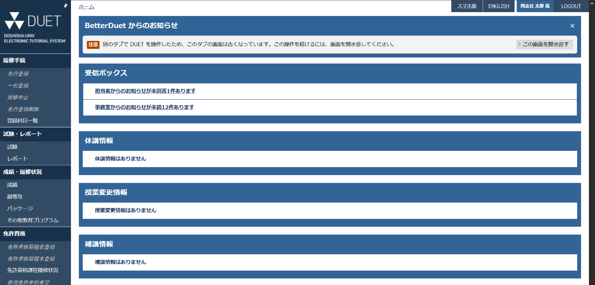
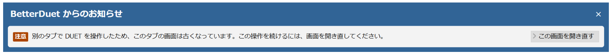
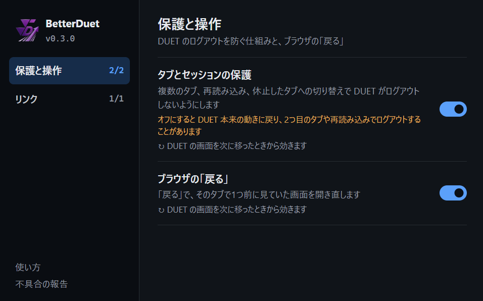

<div align="center">


# BetterDuet

同志社大学の DUET を、もっと使いやすく。

[](https://github.com/kmch4n/BetterDuet/releases/latest)
[](https://github.com/kmch4n/BetterDuet/releases)

[](LICENSE)

[**ダウンロード**](https://github.com/kmch4n/BetterDuet/releases/latest) ・ [インストール](#インストール) ・ [仕様書](docs/spec/README.md) ・ [不具合の報告](https://github.com/kmch4n/BetterDuet/issues)

</div>

DUET を複数のタブで開いても、再読み込みしても、ブラウザの「戻る」を押しても、ログアウトされずに使い続けられるようにする Chrome 拡張機能です。

DUET のサーバーは、ログインごとに「いま表示している画面」を1つだけ覚えていて、それに合わない操作を1回でも受けると、すべてのタブをログアウトさせます。2つ目のタブを開く、再読み込みする、しばらく放っておいたタブに戻る、といった普通の操作がこれに当たります。BetterDuet は、これらの操作を拡張機能の側で受け止め、DUET を普通の Web サイトと同じ感覚で使えるようにします。

> [!NOTE]
> 同志社大学および DUET の運営とは関係のない、個人による非公式の開発です。

## できること

| 機能 | 内容 |
|---|---|
| **複数タブでの利用** | タブの複製や SSO ポータルから、DUET のタブを増やして行き来できる |
| **再読み込みで壊れない** | 再読み込み、休止していたタブへの切り替え、ブラウザの再起動後も、同じ画面を開き直す |
| **自動で入り直す** | DUET のセッションが切れていても、SSO ポータルを通らずに入り直す |
| **ブラウザの「戻る」** | 「戻る」ボタンや Alt+← で、1つ前に見ていた画面に戻れる |
| **外部リンクを新しいタブで開く** | 参照URLやマニュアルの PDF が、別ウィンドウではなく新しいタブで開く |
| **機能ごとのオン・オフ** | ツールバーのアイコンから、上の機能を1つずつ切れる |

## 画面

画面写真の氏名は架空のものに置き換えています。

### 複数のタブ



どのタブでも、サイドメニューやヘッダーの操作はそのまま使えます。拡張機能が、最後に操作したタブの画面に合わせて送り直すため、DUET からは1つのタブで操作しているように見えます。

一覧の行や登録ボタンのように、その画面にしかない操作は、別のタブで操作したあとに押すとログアウトの原因になります。BetterDuet はこれを送らずに止め、画面の上に帯で知らせます。帯の「この画面を開き直す」を押すと、そのタブで同じ画面を開き直し、続きの操作ができるようになります。



帯は DUET の画面の見出しや説明文の枠に合わせた見た目にしています。

### 再読み込みと休止したタブ

再読み込みボタンを押したり、メモリセーバーで休止していたタブに戻ったりしても、同じ画面がもう一度表示されます。詳細の画面（メッセージの本文など）で再読み込みしたときは、その一覧の画面を開き直します。

DUET のセッションが時間切れなどで終わっていても、大学の SSO のログインが残っていれば、拡張機能が自動で入り直します。SSO のログインまで切れているときだけは、SSO ポータルからログインし直してください。

### ブラウザの「戻る」

DUET では「戻る」を押すと「ブラウザの『戻る』ボタンは利用できません」という警告が出ますが、BetterDuet を入れると、そのタブで1つ前に見ていた画面が開きます。ホーム → 成績確認 → お知らせ と進んだタブで「戻る」を押すと成績確認が、もう一度押すとホームが表示されます。「進む」は使えません。

### 設定画面



ツールバーの BetterDuet のアイコンを押すと、設定画面が開きます。最初はすべての機能がオンです。DUET の動きがおかしいと感じたら、拡張機能を外す前に、関係しそうな機能だけをオフにしてみてください。

- 切り替えは、DUET の画面を次に移ったときから効きます。開いているタブが勝手に再読み込みされることはありません
- 「タブとセッションの保護」をオフにすると、DUET 本来の動きに戻ります。2つ目のタブや再読み込みでログアウトすることがあり、この間は「戻る」も使えません

### できないこと

- 履修登録やアンケートなど、入力中の内容は、画面を開き直すと空になります
- 一定時間操作しないと DUET 側でログアウトされます。拡張機能では延ばせません
- DUET のログアウトボタンを押すと、すべてのタブがログアウトします。続けるには SSO ポータルから開き直してください

すべての動きと理由は [仕様書](docs/spec/README.md) にまとめています。

## インストール

BetterDuet は [GitHub Releases](https://github.com/kmch4n/BetterDuet/releases) で配布しています。Chrome の「パッケージ化されていない拡張機能」として読み込んで使います。Chrome 111 以降が必要です。

1. [最新リリース](https://github.com/kmch4n/BetterDuet/releases/latest)から `BetterDuet_vX.Y.Z.zip` をダウンロードする
2. zip を展開し、中身を置いておくフォルダ（例: `ドキュメント\BetterDuet`）に移す
3. Chrome で `chrome://extensions/` を開き、右上の「デベロッパー モード」をオンにする
4. 「パッケージ化されていない拡張機能を読み込む」を押し、手順2のフォルダを選ぶ
5. 開いている DUET のタブがあれば閉じて、SSO ポータルから DUET を開き直す

読み込めば、DUET を開いたときに自動で働きます。機能を切りたいときは、ツールバーのアイコンから設定画面を開きます。

> [!IMPORTANT]
> 読み込んだフォルダは削除・移動しないでください。Chrome はそのフォルダから拡張機能を読み込み続けます。

### 更新

自動では更新されません。新しいリリースが出たら、次の手順で入れ替えます。

1. 新しい zip をダウンロードして展開する
2. 読み込んでいるフォルダの中身を、展開したファイルで上書きする
3. `chrome://extensions/` で BetterDuet の再読み込みボタン（↻）を押す
4. 開いている DUET のタブを閉じて、SSO ポータルから開き直す

> [!TIP]
> リポジトリ右上の **Watch → Custom → Releases** をオンにすると、新しいリリースが出たときに GitHub から通知が届きます。

## データの扱い

- 処理はすべてブラウザの中で行い、DUET（`duet.doshisha.ac.jp`）以外とは通信しません
- DUET へのリクエストは、利用者が押したボタンや開いたタブのために必要なものだけを送ります。裏で画面を巡回したり、ログインを延ばすための通信をしたりはしません
- 覚えておくのは、最後に表示した画面の種類と、DUET のフォームの送信先などの動作に必要な情報だけです。成績や氏名などの画面の内容は保存しません。保存先はブラウザを閉じると消える場所（`chrome.storage.session` とタブごとの `sessionStorage`）です
- 設定画面のスイッチのオン・オフだけは、ブラウザを閉じても残るよう `chrome.storage.local` に保存します

| 権限 | 用途 |
|---|---|
| `storage` | 最後に表示した画面の記録（ブラウザを閉じると消える）と、設定画面のスイッチ |
| `declarativeNetRequest` | 再読み込みなどで DUET のページを開き直す要求を、DUET に届く前に止める |
| `duet.doshisha.ac.jp` へのアクセス | DUET の画面で動くため |

## 開発に参加する

不具合の報告、要望、Pull Request を歓迎します。BetterDuet は仕様駆動開発で進めていて、動作はすべて [仕様書](docs/spec/README.md) で決めています。

- 開発の進め方と決まりごと: [CONTRIBUTING.md](CONTRIBUTING.md)
- 不具合の報告・要望: [Issues](https://github.com/kmch4n/BetterDuet/issues/new/choose)
- 脆弱性の報告: [SECURITY.md](SECURITY.md)
- 実装の仕組み: [docs/TechNote.md](docs/TechNote.md)
- テストと実機での確認: [docs/DEVELOPMENT.md](docs/DEVELOPMENT.md)
- DUET 自身の挙動の記録: [docs/spec/duet-platform.md](docs/spec/duet-platform.md)

ビルドは不要で、`extension` フォルダがそのまま拡張機能になります。リポジトリを取得し、上の手順4で `extension` フォルダを読み込めば手元のソースで動きます。

```bash
node --test tests/*.test.js
```

e-class を使いやすくする拡張機能 [BetterE-class](https://github.com/kmch4n/BetterE-class) もあります。

> [!WARNING]
> DUET の画面構成が変わると、予告なく動かなくなることがあります。利用は各自の判断でお願いします。本拡張機能の利用によって生じた損害について、作者は責任を負いません。
